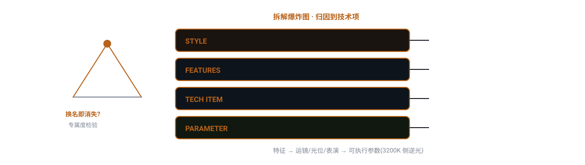

# domn-film-style-deconstruct


> 把一种已存在的视觉风格（日剧/王家卫/赛博朋克…）逆向拆成摄影指导能照做的「可执行参数表」，并拍成冷面吐槽式教程片。

## 真实产出样例

下面是这个技能**实际会产出**的东西（抽自仓库内的 references/ 真实交付样例），不是抽象描述：

```text
专属度检验正反例：
- 边走边说——美剧也这么拍，是通用手艺，剔除
- 怼脸特写+眼泪不掉——韩剧更典型，剔除
- 日剧跑——"日剧跑"这个词换掉日剧就不存在
- 皮鞋特写+户外也保留硬底回声——换了风格就没有这条规矩
判据：清单里至少一半以上是"换了风格就不成立"的，否则你拆的是"电视剧怎么拍"不是"这个风格怎么拍"。
技术归因表行格式：| # | 特征 | 技术项(运镜/光位/表演/剪辑/美术/声音) | 参数(照做就能出来) | 理由 |
```

## 是什么

把一种已存在的视觉风格（日剧/王家卫/赛博朋克…）逆向拆成摄影指导能照做的「可执行参数表」，并拍成冷面吐槽式教程片。 本仓库是一个 Agent 技能（SKILL.md 为唯一权威定义），把上面的方法论沉淀为可被对话触发的可执行流程。

## 为什么不同

用「专属度检验」(换掉风格名这条还成立吗？) + 「本质检验」(特征服务于什么一句答出) 两道关，把吐槽套路归回技术层；笑点只落套路上不落人身上——拆得越认真越好笑。

## 怎么做（工作流）

<p align="center">
  
</p>

> 换名即消失的才是风格；笑点只落套路不落人

1. **定风格** — 切到可识别、可取样的小范围
2. **取样** — ≥3 独立源只记共同条目，8–15 条
3. **归因** — 每条归到镜语六项/叙事一项，归不了剔除
4. **参数化** — 写可执行参数（“3200K 侧逆光左后45°”而非“温柔的光”）
5. **验真** — 比对 3 部代表作，对不上回炉
6. **写文案分镜** — 冷面吐槽体，口播逐段落镜

## 怎么用

将本仓库放入支持 `SKILL.md` 的 Agent 技能目录：

- **WorkBuddy**：`~/.workbuddy/skills/domn-film-style-deconstruct/`
- **Codex / 其他**：对应 skills 目录

然后在对话中触发，例如：

```
用 domn-film-style-deconstruct 拆解王家卫风格，输出技术参数表。
```

## 依赖

纯提示词方法论 + references/ 弹药库；生视频依赖文生视频模型（即梦 Seedance / Kling / 可灵等），提示词喂给这些模型执行。

## 仓库结构

```
domn-film-style-deconstruct/
├── SKILL.md                 # 技能定义（唯一权威）
├── assets/                  # 模板 / 占位素材
├── references/              # 方法论弹药库
└── assets/readme/           # 本 README 的视觉资产（hero.webp / workflow.svg）
```

## 许可

本仓库内容以 `SKILL.md` 为唯一权威定义。如附带 `LICENSE` 文件，以其为准。

---

*README 由 `beautify-github-readme` 生成 · 封面图来自作者作品集，强调色由封面采样派生；工作流图为每技能独立 motif。*